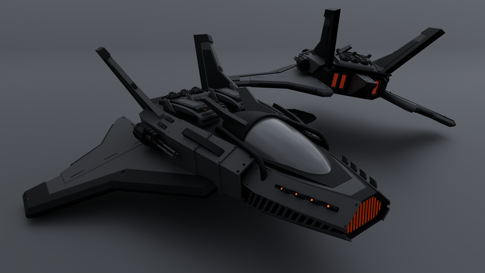

# HardSurfaceSpaceshipPractice

This repository documents my progress applying the techniques and workflows learned through The Hard Surface Accelerator by Blender Bros to create a detailed sci-fi spaceship model.

The goal of this project is to put hard-surface modeling concepts into practice, develop proficiency in professional Blender workflows, and apply the skills learned throughout the tutorial series to design and model a complete spaceship.

